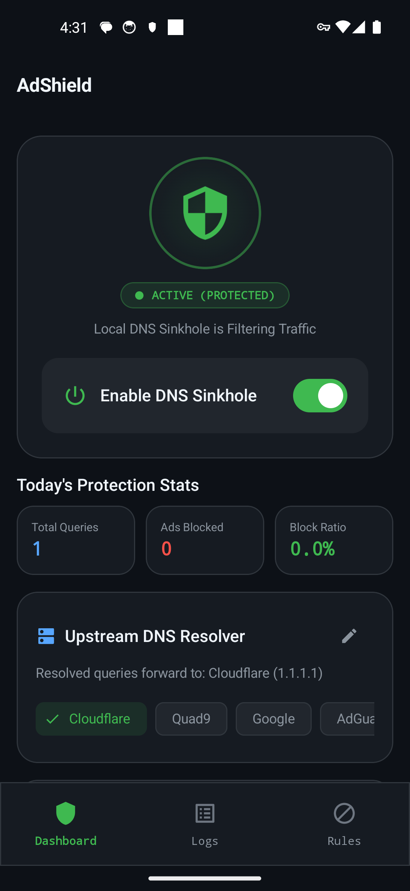
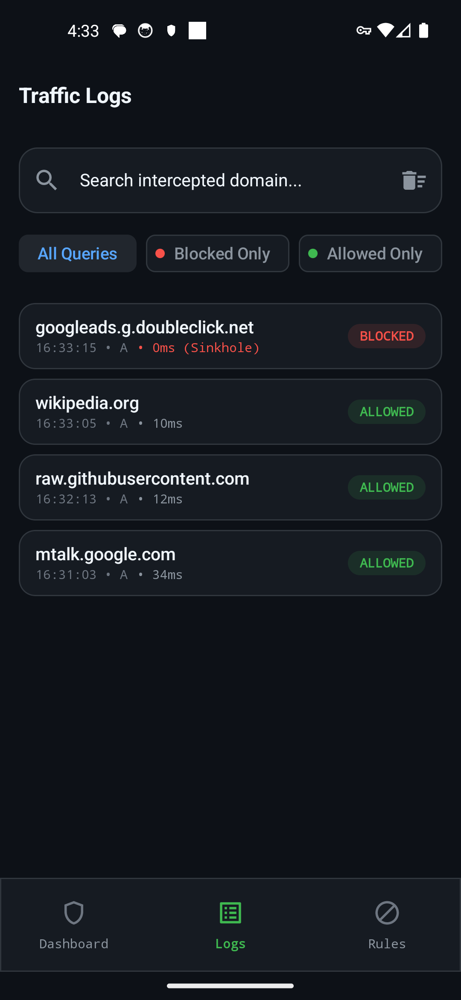
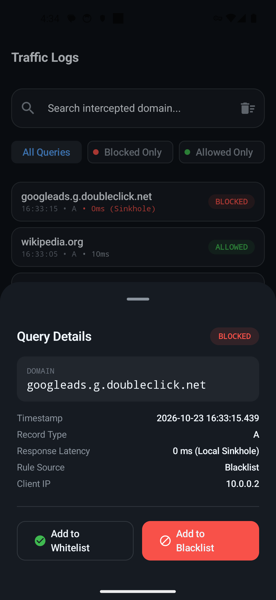
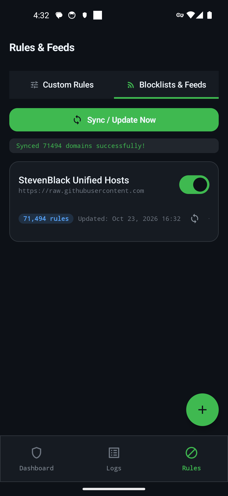
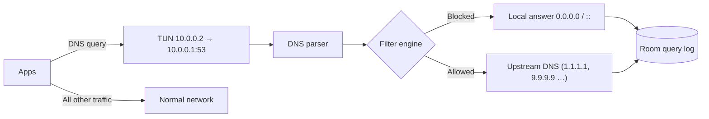

<div align="center">

# 🛡️ AdShield

**A lightweight, 100% on-device DNS sinkhole for Android.**
Blocks ads, trackers, malware and phishing domains system-wide — no root, no remote server, no subscription.

[](../../actions/workflows/android.yml)







</div>

---

## Features

- **System-wide blocking** using Android's `VpnService` — works in every app and browser.
- **DNS-only tunnel** — only DNS packets go through AdShield; all other traffic uses the normal network stack, so there's no slowdown and almost no battery cost.
- **Instant sinkhole** — blocked domains get a local `0.0.0.0` / `::` answer in under a millisecond, without touching the network.
- **Ready out of the box** — ships with built-in baseline rules and pre-enabled feeds (StevenBlack Unified, URLhaus malware, Phishing Army) that sync automatically on first launch and every 24 h on Wi-Fi.
- **Live traffic inspector** — see every query in real time, filter by status, and whitelist/block a domain with one tap.
- **Custom rules** — your own whitelist and blacklist, with wildcard subdomain matching (`doubleclick.net` also blocks `*.doubleclick.net`).
- **Selectable upstream DNS** — Cloudflare, Quad9, Google, AdGuard, or a custom IP.
- **Auto-start on boot** — protection comes back after a reboot or app update (until you turn it off).
- **Private by design** — no analytics, no accounts, no data leaves the phone except the DNS lookups you'd make anyway.

## How it works



1. The VPN interface sets `10.0.0.1` as the system DNS server and routes **only** `10.0.0.1/32` into the tunnel.
2. `DnsPacketHandler` parses RFC 1035 UDP packets and extracts the `QNAME`.
3. `DomainFilterEngine` checks it against an in-memory reverse-label trie (whitelist wins over blacklist).
4. Blocked → a synthetic response is written straight back to the tunnel. Allowed → the query is forwarded through a `protect()`-ed socket to the upstream resolver.
5. Every query is logged asynchronously to Room for the inspector and stats.

## Install

### Option 1: Download
Grab the latest APK from [Releases](../../releases) (or the `app-debug` artifact of the latest CI run) and install it.

### Option 2: Build from source
Requirements: JDK 17, Android SDK (API 35), a device or emulator with USB debugging.

```bash
git clone https://github.com/bazobehram/adShield.git
cd adShield
./gradlew :app:assembleDebug
./scripts/deploy.sh -d          # or -e for emulator; Windows: .\scripts\deploy.ps1 -d
```

### First launch
1. Open AdShield and turn on **Enable DNS Sinkhole**.
2. Accept Android's one-time VPN connection prompt.
3. That's it — feeds sync in the background.

> [!TIP]
> For maximum reliability enable **Settings → Network & internet → VPN → AdShield ⚙ → Always-on VPN**.

> [!IMPORTANT]
> If **Private DNS** (Settings → Network & internet → Private DNS) is set to a hostname, Android sends DNS over TLS directly and bypasses AdShield. Set it to **Off** or **Automatic**.

## Limitations

- DNS-level blocking can't remove ads served from the same domain as content (e.g. YouTube video ads).
- Apps/browsers with their own built-in DNS-over-HTTPS (some Chrome/Firefox settings) bypass system DNS.
- Android allows only one active VPN at a time, so AdShield can't run alongside another VPN app.

## Tech stack

Kotlin · Coroutines & Flow · Jetpack Compose (Material 3) · Room · WorkManager · MVVM

```
app/src/main/java/com/local/adshield/
├── vpn/          AdShieldVpnService, DnsPacketHandler, DomainFilterEngine
├── data/         Room DB, DAOs, repositories, sync worker, preferences
├── receiver/     BootReceiver
└── ui/           Dashboard, Traffic Inspector, Rules & Feeds
```

## Default blocklists

| Feed | Purpose | Default |
|---|---|---|
| [StevenBlack Unified Hosts](https://github.com/StevenBlack/hosts) | Ads & trackers | ✅ |
| [URLhaus Malware Filter](https://gitlab.com/malware-filter/urlhaus-filter) | Malware & ransomware | ✅ |
| [Phishing Army Extended](https://phishing.army/) | Phishing & scams | ✅ |
| [AdGuard DNS Filter](https://github.com/AdguardTeam/HostlistsRegistry) | Mobile ads | ➖ (optional) |

You can add any hosts-file or plain domain-list URL from the **Rules → Blocklists & Feeds** tab.

## Contributing

Contributions are very welcome! Please read [CONTRIBUTING.md](CONTRIBUTING.md) to get started, and check the issues labelled **good first issue**.

## License

[MIT](LICENSE) — blocklists are provided by their respective maintainers under their own licenses.
